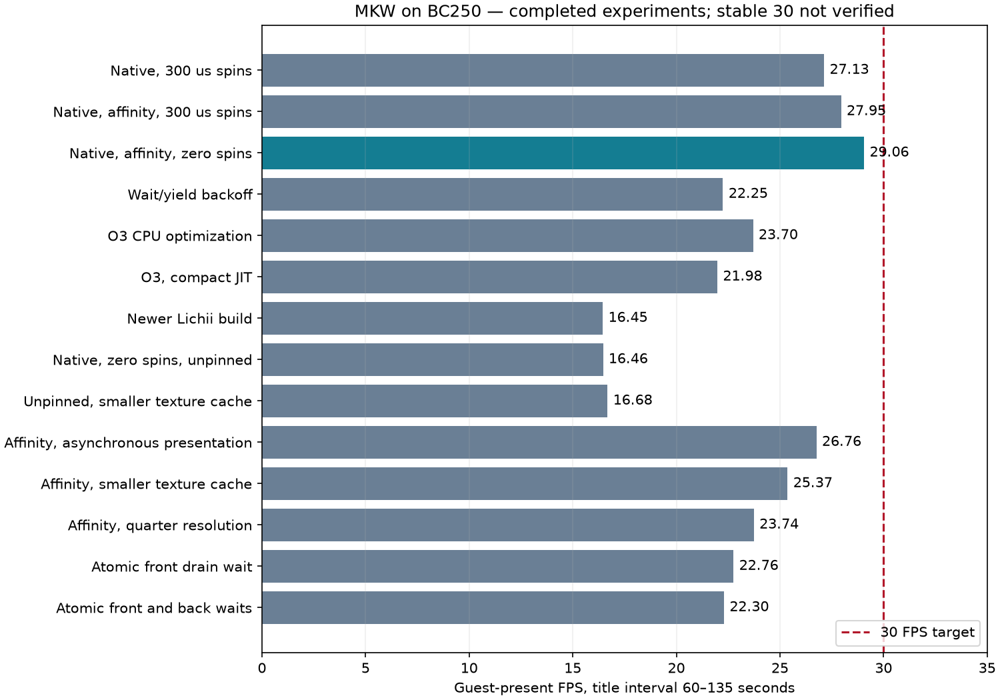

# BC250 Mario Kart World title performance investigation

**Stable 30 FPS was not achieved.** The best measured title-interval average was 29.06 FPS at 0.5x resolution, with 15-second windows from 24.79 to 31.06 FPS. Its 99th-percentile frame time was about 143 ms. These measurements do not qualify a stable-30 profile.

This preserves the measurements and optional wait prototypes from the investigation. The startup profile and shared relay helper are tracked separately in [PR #108](https://github.com/heydemoura/EglantinePS5/pull/108).

## Measurement and scope

- Bazzite on AMD BC-250, RADV GFX1013, 16 logical CPU threads; MKW title reports version 1.8.0.
- Each completed candidate ran for a bounded 180-second capture. FPS is the change in the actual guest-present counter divided by wall time over 60–135 seconds. Frame generation was disabled. Screenshots at 60 and 120 seconds confirmed the title; the later attract-demo interval is excluded.
- Candidates ran sequentially through the shared board lock. Other agents’ games were allowed to finish. Dynamic title backgrounds and cache/memory states differed between runs, so these are individual observations rather than repeated, scene-matched causal benchmarks.
- CPU percentages below are normalized over 16 logical processors. GPU percentages are process graphics-engine activity from DRM fdinfo. RSS and GPU allocations can overlap on unified memory and must not be added as independent totals.
- The best run’s per-frame timing comes from MangoHud, aligned to the launch timestamp with approximately one-second precision. About 8% of title frames exceeded 50 ms. See [frame-pacing data](evidence/mkw-title-performance/best-frame-pacing.json).

## Completed captures

| Candidate | Title FPS | Peak RSS GiB | Mean CPU % | Mean GPU engine % | Peak system swap GiB |
|---|---:|---:|---:|---:|---:|
| Native, 300 us spins | 27.13 | 9.71 | 29.8 | 28.1 | 1.50 |
| Native, affinity, 300 us spins | 27.95 | 9.66 | 28.8 | 27.0 | 1.48 |
| Native, affinity, zero spins | 29.06 | 8.92 | 26.4 | 29.8 | 2.83 |
| Wait/yield backoff | 22.25 | 9.34 | 30.0 | 25.7 | 2.84 |
| O3 CPU optimization | 23.70 | 9.25 | 27.2 | 30.4 | 2.03 |
| O3, compact JIT | 21.98 | 9.32 | 25.5 | 29.6 | 5.08 |
| Newer Lichii build | 16.45 | 7.56 | 21.3 | 22.4 | 5.74 |
| Native, zero spins, unpinned | 16.46 | 7.79 | 24.5 | 29.5 | 5.01 |
| Unpinned, smaller texture cache | 16.68 | 8.56 | 24.7 | 30.7 | 3.91 |
| Affinity, asynchronous presentation | 26.76 | 9.78 | 27.4 | 26.8 | 3.22 |
| Affinity, smaller texture cache | 25.37 | 7.16 | 25.6 | 30.3 | 5.04 |
| Affinity, quarter resolution | 23.74 | 9.41 | 25.6 | 25.1 | 4.08 |
| Atomic front drain wait | 22.76 | 9.39 | 23.0 | 30.7 | 4.40 |
| Atomic front and back waits | 22.30 | 9.32 | 24.0 | 22.5 | 3.95 |



Raw telemetry, run summaries, available environment/build receipts, and the comparison JSON are in [the evidence directory](evidence/mkw-title-performance). Final summaries for the newer Lichii and compact-JIT captures were reconstructed from intact telemetry and GNU time after a post-capture metadata-writer exception; their run receipts record that limitation.

The 10 GiB layout faulted at an unmapped address zero before presenting frames. An initial zero-spin attempt quit normally before measurement, and the first newer-build attempt stopped at profile import detection. Those attempts are excluded from the table. The newer-build retry used isolated Lichii data/config/cache. The GPU rejected the requested high policy; `auto` was restored.

## CPU profile and wait prototypes

A separate diagnostic capture enabled Dynarmic JIT symbol maps and sampled user CPU time at 99 Hz during seconds 60–90. It collected 9,119 samples. Its FPS is excluded because instrumentation changes overhead. The [whitespace-normalized report](evidence/mkw-title-performance/perf-summary.txt) attributed 4.49% of sampled CPU time to `GpuSplit::Drain`, 3.25% to `BackLoop`, and additional time to guest JIT code and queue processing. This identifies CPU costs, not a proven root cause for every frame-time spike.

Two archived, default-off prototypes use `EDEN_NX2_BLOCKING_DRAIN=1`:

1. After 64 front-thread spins, wait on the observed consumed position. Notify that atomic after both partial and final back-thread progress stores. Preserve the full-drain equality and partial-drain lower-bound conditions.
2. Additionally shorten the back-thread idle spin from 8,192 to 64 before its existing sleep/wake protocol.

The prototypes averaged 22.76 and 22.30 FPS. Both reached deliberate timeout exit 124; scans found no matching unmapped-instruction, guest-panic, device-loss or failed-allocation/OOM patterns. The kernel journal had no entries over their verification window. These bounded observations do not certify race/gameplay stability or establish a speedup. Neither prototype was promoted to the installed launcher.

## Reproduce the protocol check

The [experiment directory](../tools/linux/experiments/mkw-title) contains the exact legacy `gpu_split.cpp` input, both patches, and a self-contained Linux x86 C++20 protocol harness. Run from the repository root:

```sh
python3 tools/linux/experiments/mkw-title/check-drain-protocol.py --patch blocking-drain.patch
python3 tools/linux/experiments/mkw-title/check-drain-protocol.py --patch blocking-drain-both.patch
```

The harness applies each patch without fuzz in a temporary directory, extracts the production `Drain`/`DrainTo` methods and progress-notification snippet, and checks 4,000 partial/final completions with notifications before and during waiting, delayed stores, and visibility of release/acquire-protected data. It exercises both flag values. It does not instantiate the complete GPU ring, renderer, idle-hook or shutdown protocol.

**These patches target the recorded older derived Linux source, not the current folded core.** The current `Eglantine/src/video_core/gpu_split.cpp` already has a different front-wake and back-quiet protocol. Do not apply the legacy patches directly to it; any port needs a fresh synchronization review, build and game qualification. The archived native/build receipts identify the source snapshot and compiler flags used. Rebuilding complete candidates also requires that snapshot, its recorded Linux patches/native-MME integration and the user-owned game; this archive alone is not a complete emulator build recipe.

Further work requires an emulator execution/memory-path optimization followed by repeatable frame-pacing qualification. This PR records negative results and testable prototypes, without claiming the 30 FPS objective is complete.
